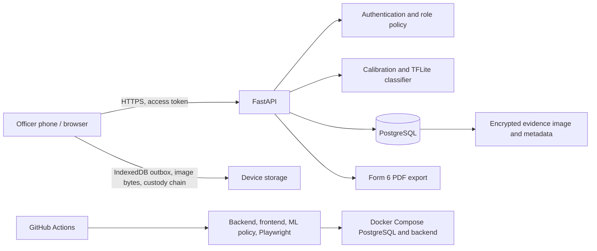

# NARCOTRACE / VIGIL

NarcoTrace is a field workflow for capturing presumptive colour-test evidence, analyzing
the image, and maintaining an auditable custody record. VIGIL is the offline-capable
React application; the backend is FastAPI with PostgreSQL and a TFLite colour classifier.

## Quick start

Requires Docker Compose, GNU Make, and Python for the local verification helper.

```sh
make setup
make dev
make seed
```

`make seed` prompts for the initial zonal administrator. Open
http://localhost:5173 (API docs: http://localhost:8000/docs). Development secrets are
generated and persisted in `narcotrace-backend/.env`. Run the third command in a second
terminal while `make dev` is running.

## Architecture



See [docs/API.md](docs/API.md), [docs/SECURITY.md](docs/SECURITY.md),
[docs/RUNBOOK.md](docs/RUNBOOK.md), [docs/I18N.md](docs/I18N.md), and
[docs/DEMO.md](docs/DEMO.md). The committed OpenAPI export is
[docs/openapi.json](docs/openapi.json).

## Verification

`make verify` starts the compose-backed test backend, resets only the E2E-prefixed seed
records, runs backend/frontend/locale/contract checks and Playwright, then prints a compact
status table. Playwright writes an HTML report to `narcotrace-frontend/playwright-report/`.
The backend coverage gate is 85% for runtime application code; ML and operational
seed/export/E2E helper modules are excluded in `narcotrace-backend/.coveragerc`.

CI checks Python 3.11 and 3.12 with SQLite and PostgreSQL 16, frontend typecheck/lint/unit
tests/build/locale parity, custody-vector parity, ML policy/runtime smoke checks, compose
E2E, dependency/image scans, and secret scanning. Configure these GitHub Actions checks as
required branch-protection statuses on `main`:

- `backend (3.11, sqlite)`
- `backend (3.11, postgres)`
- `backend (3.12, sqlite)`
- `backend (3.12, postgres)`
- `ML policy and runtime smoke`
- `frontend quality and generated contracts`
- `compose-backed Playwright E2E`
- `dependency, image and secret scans`

GitHub branch protection is repository configuration and must be enabled by an owner; this
repository workflow cannot change that setting.

## Known limitations

- The model is validated on synthetic data only; it is not validated on real lab photos.
- Kit charts are unverified and must be checked against the exact manufacturer's chart.
- Form 6 wording is a clearly marked placeholder and has not been legally reviewed.
- Translations are drafts and have not been native-speaker reviewed.
- Current evidence image and custody integrity checks detect tampering but do not yet have
  an automated daily signed Merkle-root anchor stored off-box.
- The full Phase 2 comparison/retraining registry and regression gates are not implemented;
  [docs/MODEL_COMPARISON.md](docs/MODEL_COMPARISON.md) records the available evidence and gap.
- Background Sync delivery requires a live authenticated app window; when the app is closed,
  the outbox resumes when the officer opens the app.

Set `ENV=prod`, `JWT_SECRET` (at least 32 characters), and `DATA_KEY_HEX` (64 hexadecimal
characters) before starting a production backend. The backend refuses to start when either
secret is missing or invalid. Never reuse development credentials in production.
